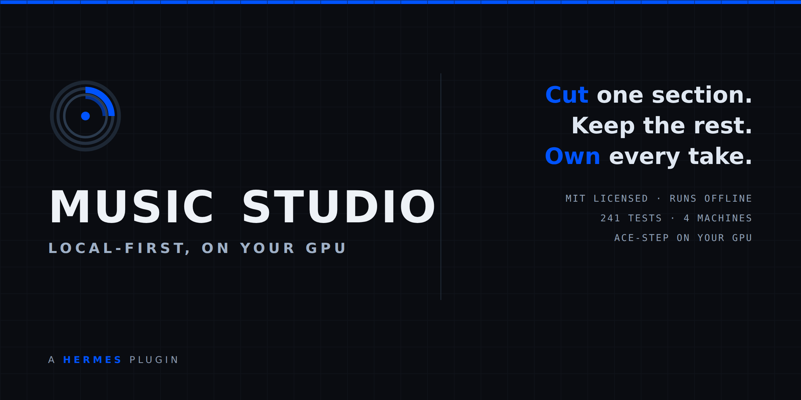
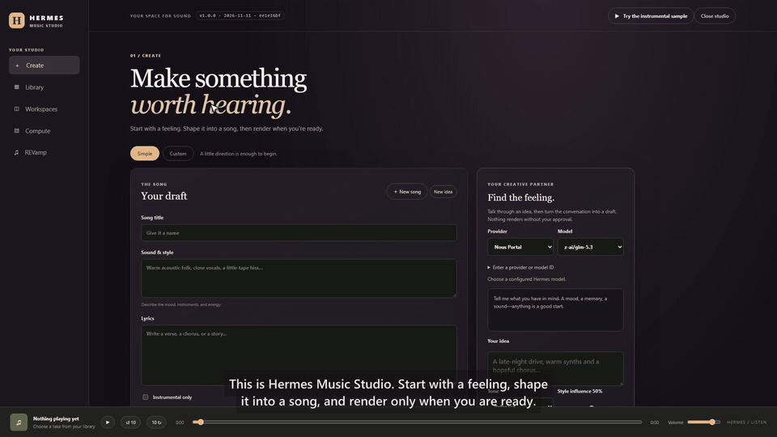
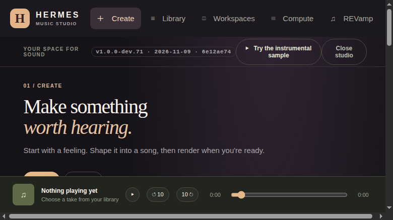
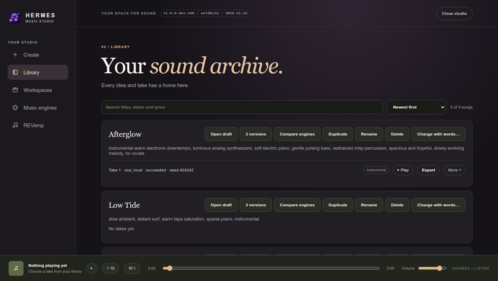
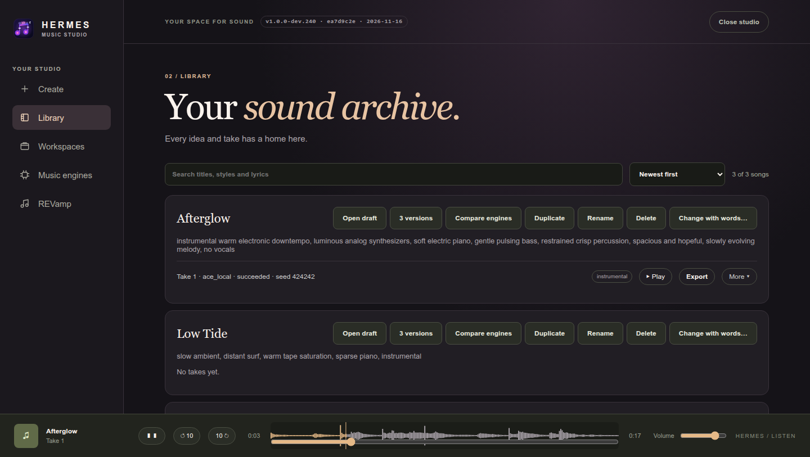
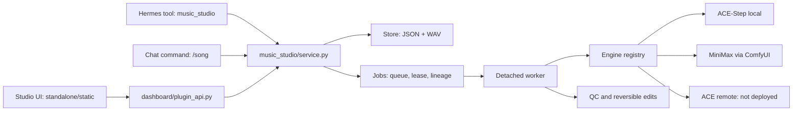

# Hermes Music Studio

[](https://github.com/KeyArgo/hermes-music-studio/actions/workflows/tests.yml)
[](TESTING.md)
[](https://github.com/NousResearch/hermes-agent/pull/154029)
[](LICENSE)
[](https://github.com/NousResearch/hermes-agent)
[](#install)
[](requirements-dev.txt)
[](package.json)
[](https://github.com/KeyArgo/hermes-music-studio/stargazers)

**Describe a song, approve the draft, and hear it rendered on your own machine.**


*The draft is the gate: nothing renders until a person approves this exact version.*

1. **Describe.** Tell the agent the song you want; it drafts the title, style, lyrics and engine.
2. **Approve.** Read the draft and approve that exact version. Nothing renders before you do.
3. **Hear.** A worker renders the take on your machine; play it, then export a normal .wav.



**Describe a song, approve the draft, hear it.** [Watch the full demo ▶](https://x.com/MHArgonaut/status/2120635407113339039)

[Install](#install) · [Features](#features) · [How it works](#how-it-works) · [Documentation](#documentation) · [Testing](#testing) · [Contributing](#contributing)

## What it is

A studio inside Hermes. Describe a feeling and the agent drafts a song: title, style, lyrics and an
engine. Nothing renders until you approve that draft. Every take keeps its draft, seed, engine and
lineage, so it can be re-made rather than lost to a lucky accident. The library, the worker and the
audio stay on your machine.

## Why it's different

- **Approval is a step, not a warning.** The render endpoint refuses a draft that was not approved,
  and an approval is bound to the exact `updated_at` version you read.
- **A take can be re-made.** Draft, seed and engine travel with the take. A seed is a replay handle
  on the same runtime and hardware.
- **The build says which build it is.** The header shows `v1.0.0-dev.N · a8310ba7 · 2026-11-16`,
  the version, commit and date filled from the running server, never from a constant in the page.
- **The product proves itself.** `GET /api/verify` measures, at request time, that the sample is real
  audio, that the library reads, that a finished take's file is a real WAV on disk, and that REVamp's absence is a state rather than an error.

## Features

- **Draft → approve → render.** Title, caption, lyrics, instrumental flag, duration, BPM, key,
  vocal language and engine, with the approval token checked inside the write lock.
- **Two working engines behind one registry.** `ace_local` runs ACE-Step 1.5 on a local GPU with
  repaint and extend. `minimax_m3_comfy` renders MiniMax Music 3 through a ComfyUI server.
  `ace_remote` renders on a remote ACE-Step API server the user adds on the Music engines page.
- **One render at a time, across processes.** A detached worker takes a file lease; a crashed worker
  is reconciled by pid and start time, so a dead render cannot wedge the profile.
- **Takes are immutable.** Repaint, extend, section splice, fade and chorus preview create child
  takes; the parent WAV and its record stay untouched.
- **Range repaint.** Regenerate 3–30 s of an ACE take, then splice it back with the audio outside the
  range copied byte for byte.
- **Extend.** Append 10–60 s to a take of at least 20 s, up to 600 s total, with an equal-gain
  crossfade at 48 kHz stereo.
- **Save spot / Back to last spot.** A checkpoint keeps the draft, the keeper take with its audio
  SHA-256, the lineage and the playhead. Twenty are kept; a pinned one is never pruned.
- **Check this take / Fix it.** Compares a take with the request that produced it, reports only what
  it measured, and can retry a measurable failure with a fresh seed.
- **Change this part, in words.** `/song change` and the library's change box are deterministic:
  "add a fiddle" edits the style caption; "mute the drums" is refused with a sentence.
- **Versions, batch, presets, compare.** Three takes from one draft, a serial batch in one worker,
  saved style presets, and an A/B compare across ready engines.
- **A real player.** Play/pause, −10 s / +10 s, a scrubber that moves the audio, elapsed and total
  time, and a volume slider. Exported songs are ordinary `.wav` files.
- **Workspaces and cover art.** Group songs; upload PNG/JPEG/WebP up to 2 MiB. The agent can save a picture as the cover with the `set_cover` action.
- **REVamp is optional.** Create a playlist from exported takes; with REVamp absent the screen says so
  and playing and exporting still work.
- **Chat and shell clients.** The `music_studio` tool has 22 actions, `/song` drives the same studio
  in chat, and `scripts/ms.py` is a standard-library HTTP client for shells and cron.
- **Honest surgery.** A tail trim and a −1 dBFS peak cap are stored as a new file with the source
  SHA-256; the raw take is never rewritten. Vocal evidence is `unknown` unless a real ASR result
  proves otherwise.

## Screenshots

**Create**: the draft and your creative partner.



**Library**: songs, takes and the More menu.



**Player**: a take playing.



**Music engines**: add a server, Test and save.


**REVamp**: add takes to a playlist.


**Compare**: engines and versions, side by side.


## Install

You need:

- **Python 3.13** with `fastapi`, `uvicorn`, `python-multipart` (`pip install -r requirements-dev.txt`)
- **Node 20+** only for the browser-side tests
- **Hermes** itself, since this ships as a plugin
- **Something to render with** — see [Limits](#limits)
- **Linux, macOS or Windows.** The plugin, the studio and the ComfyUI engine run on all three, and
  CI tests all three. Local ACE-Step rendering needs a CUDA GPU and has been run on Linux only.

```bash
hermes plugins install KeyArgo/hermes-music-studio --yes-deps --enable
```

To pin an exact revision (what CI and the release script do):

```bash
hermes plugins install KeyArgo/hermes-music-studio --ref <full 40-character sha> --yes-deps --enable
```

A short SHA destroys the checkout; the installer needs all 40 characters. The desktop pane appears
after **Ctrl+K → Reload desktop plugins**.

Running from a clone instead:

```bash
git clone https://github.com/KeyArgo/hermes-music-studio
cd hermes-music-studio
pip install -r requirements-dev.txt
TOKEN=$(python3 -c 'import secrets; print(secrets.token_urlsafe(32))')
HEWN_STUDIO_TOKEN=$TOKEN python3 -m uvicorn standalone.app:app --port 8770
# then open http://127.0.0.1:8770/?token=$TOKEN — the host refuses /api without it   # the studio on its own, no Hermes needed
```

### Upgrade

Updates come through Hermes; the studio never replaces its own code:

```bash
hermes plugins update hermes-music-studio
```

Then restart Hermes (quit Hermes Desktop fully and open it again, or `hermes gateway restart`) so the studio loads the new version.

### Uninstall

```bash
hermes plugins uninstall hermes-music-studio
```

Uninstalling removes the plugin, not your library. Your projects and WAV files stay in the plugin data
folder until you delete it.

### Where your data lives

The plugin library lives under
`~/.hermes/profiles/<profile>/plugin-data/hermes-music-studio/` (or under `HERMES_HOME` when set).
The standalone server uses `$XDG_DATA_HOME/hewn-music-studio`, or
`~/.local/share/hewn-music-studio` when `XDG_DATA_HOME` is unset. Set `HEWN_STUDIO_DATA_DIR` to point
either at a different root. Settings, targets, presets and checkpoints live beside it; deleting the
folder deletes every project, take and WAV. Other folders and environment variables are listed in
[docs/CONFIGURATION.md](docs/CONFIGURATION.md).

## Quick start

1. Install the plugin and reload the desktop pane.
2. Open the pane and describe a song in **Create**. Pick an engine and length.
3. Press **Save draft**, read the draft, then **Approve draft**.
4. Press **Build the full song**. A detached worker renders it; the progress panel reports the take.
5. Play it in the footer, then **Export** it as a normal `.wav`.

With no engine installed, the studio still opens, the sample still plays, and the engine panel names
what is missing. It does not invent audio.

## How it works



The agent tool, the `/song` command and the dashboard all call `music_studio/service.py`. A generate,
repaint, extend or batch call queues a take and spawns `python -m music_studio.worker` in a new
session. The worker opens the render lease, claims its take, renders through the engine registry,
commits `succeeded` or `failed`, runs the quality pass, and exits. The requesting turn or HTTP request
can end immediately. `music_studio/jobs.py` owns the state machine, `music_studio/worker.py` owns the
render loop, and `music_studio/engines/` is the only place that knows a backend. The UI is plain
HTML/CSS/JS with no build step; `desktop/plugin.js` only frames the loopback host.

## Choosing a model

By default, the studio uses your Hermes model. To use a different provider or model, run these commands once:

```bash
hermes config set plugins.entries.hermes-music-studio.llm.allow_provider_override true
hermes config set plugins.entries.hermes-music-studio.llm.allow_model_override true
```

Then restart Hermes. The model picker in Create always lists Hermes' providers and their models; without these two settings Hermes only lets the studio use your Hermes model, and the studio tells you so instead of quietly switching. Pick any provider and model, or type a provider and model id. Your choice is remembered in your browser.

Providers you have set up in Hermes are marked ready. The studio connects through your Hermes installation, never directly; API keys stay in Hermes' credential store.

## Documentation

| Document | What it covers |
|---|---|
| [docs/README.md](docs/README.md) | Index of every document |
| [docs/GETTING-STARTED.md](docs/GETTING-STARTED.md) | **Start here.** Your first song in 5 steps, and how to find your ComfyUI address |
| [docs/USAGE.md](docs/USAGE.md) | Every user-facing feature, with screenshots |
| [docs/REFERENCE.md](docs/REFERENCE.md) | Every tool action, slash command, CLI command, HTTP route and config key |
| [docs/ARCHITECTURE.md](docs/ARCHITECTURE.md) | Processes, locks, state machine, data directory, route table |
| [docs/CONFIGURATION.md](docs/CONFIGURATION.md) | Environment variables and saved settings |
| [docs/TROUBLESHOOTING.md](docs/TROUBLESHOOTING.md) | Real failure modes and what they mean |
| [docs/AUDIO-QC.md](docs/AUDIO-QC.md) | The measurement gate: lengths, edits, vocal evidence |
| [docs/FAQ.md](docs/FAQ.md) | Short answers to the usual questions |
| [docs/DEVELOPMENT.md](docs/DEVELOPMENT.md) | Repo layout, test commands, CI |
| [TESTING.md](TESTING.md) | How to run each suite and the measured counts |
| [LIMITS.md](LIMITS.md) | What is unsupported, unmeasured or refused |
| [VERIFY.md](VERIFY.md) | Recorded measurements and the commands behind them |
| [CHANGELOG.md](CHANGELOG.md) | What changed in each release |
| [BACKEND.md](BACKEND.md) | The operator's short version of the architecture |
| [THIRD-PARTY.md](THIRD-PARTY.md) | Models, services and licences |
| [CONTRIBUTING.md](CONTRIBUTING.md) | Dev setup and the rules a change must keep |
| [SECURITY.md](SECURITY.md) | Supported version and private reporting |

## Privacy & security

- **What it stores.** Project JSON, raw take WAVs, QC edit WAVs, `engine-preference.json`,
  `presets.json`, `comfy-targets.json`, `comfy-workflows.json`, `studio-workspaces.json`, `engine-settings.json`,
  `library.json`, checkpoint files and worker logs, all under the plugin data directory you chose.
  Audio is opened with `O_NOFOLLOW`, checked as a regular file, and served with `nosniff`.
  API keys are stored through Hermes' own credential store; the plugin never writes a key to its data
  directory.
- **Network calls.** The studio calls only addresses you give it: a ComfyUI server (added on the
  Music engines page, a saved target, or `COMFYUI_URL`; a custom workflow contacts only the endpoint
  saved with it), an optional ACE-Step HTTP server (`ACE_REMOTE_URL` or the Music engines page), and
  REVamp's local API at `127.0.0.1:8114`. **Look on this computer** checks only `127.0.0.1` ports 8000
  and 8188. Only when you press the buttons does it reach your configured Hermes model and image
  providers (creative partner and cover art), each Hermes provider's public model list when the model
  picker loads (no key is sent), and Hugging Face for weights. **Download ACE-Step 1.5** fetches only
  the four files of `Comfy-Org/ACE-Step-1.5` pinned at revision
  `371bb1680f8c88d8c1083f6ffb6330d3d55bff76` (`split_files/diffusion_models/acestep_v1.5_turbo.safetensors`,
  `split_files/text_encoders/qwen_0.6b_ace15.safetensors`, `split_files/text_encoders/qwen_4b_ace15.safetensors`,
  `split_files/vae/ace_1.5_vae.safetensors`; 14.7 GB in all), and checks each against its SHA-256 before
  using it. The older Hugging Face download (`POST /api/studio/setup/hf`) fetches the model you name. The
  studio runs no installer, `git` or `pip`, sends no telemetry and has no cloud audio service. **Copy my
  engines** puts each saved engine's name, address and ready model list, plus the ACE-Step server
  address, on your clipboard; keys are never included, and a custom workflow's graph stays on the
  computer that saved it. "Check for a newer
  build" reports that Hermes owns updates; the studio does not fetch or install code itself. ComfyUI
  Desktop is installed by you and may update itself.
- **Background processes.** A detached render worker per render (or batch), an ACE-Step subprocess in
  the runtime's own venv, a loopback studio host (`127.0.0.1`, a free port near 8775), `ffmpeg` for
  MiniMax's FLAC → WAV transcode, and read-only `nvidia-smi` probes for GPU attribution. The
  creative partner drafts through Hermes' plugin LLM interface (`ctx.llm`), cover art is made by the
  agent's own image tool and handed over as a file, and REVamp actions run `revampctl`.
- **Shell commands.** `git` is read for the version stamp. The studio never runs a shell string from
  user text and never changes a password. The only credential it writes is the hosted API key you
  enter, saved through Hermes' own credential store.
- **Local only.** The HTTP server binds loopback and rejects a non-loopback `Host`. Every `/api` route
  also requires the per-launch token the host writes into `studio-host.json` (0600): no token means
  503, a wrong token means 401. It is single-user, so do not expose it to a network.

Read [SECURITY.md](SECURITY.md) for the supported version and private vulnerability reporting.

## Testing

```bash
# Python: contract, HTTP surface, store, jobs, engines against fakes
env -u PYTHONPATH TMPDIR=/tmp python3 -m pytest --rootdir=tests tests -q

# Browser-side logic: the player, the pane, the settings screen
npm install          # once
node --test tests/*.mjs
```

| Suite | Command | Measured result |
|---|---|---|
| Python | `env -u PYTHONPATH TMPDIR=/tmp python3 -m pytest --rootdir=tests tests -q` | **1097 passed, 2 skipped, 139 subtests passed** |
| Browser-side | `node --test tests/*.mjs` | **254 passed** |
| Total | both suites | **1351 passed, 2 skipped** |

`env -u PYTHONPATH` matters: a Hermes checkout on the path ships its own `tests` package, which wins
over this repo's folder and makes collection fail. The full breakdown, CI commands and the exact
summary lines are in [TESTING.md](TESTING.md).

## Limits

- **No model ships here.** Rendering needs a reachable engine: a ComfyUI host with MiniMax Music 3, or
  a local ACE-Step checkout. With neither, the studio still opens, the sample still plays, and the
  engine panel says what is missing.
- **One render at a time per profile.** A second generate returns `GPU busy`.
- **No automated test performs a real render.** The suites use fake engines. Audio quality is judged
  by listening.
- **MiniMax cannot repaint or extend**, and `ace_remote` is registered but undeployed.
- **A seed reproduces on the same runtime and hardware**, not across GPUs or checkpoints.
- **CI covers all three platforms.** The suites run on Linux, macOS and Windows. Real-hardware use
  has been on Linux, and local ACE-Step rendering on Windows or macOS is untested.

The complete list, with the code that enforces each item, is in [LIMITS.md](LIMITS.md).

## Contributing

Contributions that keep the honesty rule are welcome: every claim backed by a command in
[VERIFY.md](VERIFY.md) or a test that fails when the claim is false. Start with
[CONTRIBUTING.md](CONTRIBUTING.md), and read the [Code of Conduct](CODE_OF_CONDUCT.md).

## License

MIT. See [LICENSE](LICENSE). Models and services carry their own licences, recorded in
[THIRD-PARTY.md](THIRD-PARTY.md).

## Acknowledgements

- [ACE-Step 1.5](https://github.com/ACE-Step/ACE-Step-1.5) (MIT) for the local music model.
- [MiniMax Music 3](https://huggingface.co/MiniMaxAI/MiniMax-Music3) for the hosted model, under its
  community licence.
- [ComfyUI](https://github.com/comfyanonymous/ComfyUI) for the MiniMax graph runner.
- [ffmpeg](https://ffmpeg.org/) for FLAC → WAV conversion.
- [Hermes Agent](https://github.com/NousResearch/hermes-agent) for the plugin host.
- [REVamp](https://github.com/KeyArgo/hermes-revamp) for the optional player integration.
- [InovinLabs](https://github.com/inovinlabs) for the product and its direction.

Special thanks to sovthpaw. A passionate advocate, a dedicated community member, and someone who genuinely gives a damn about open AI. Respect doesn't require agreement.

Built by [KeyArgo](https://github.com/KeyArgo) · InovinLabs
