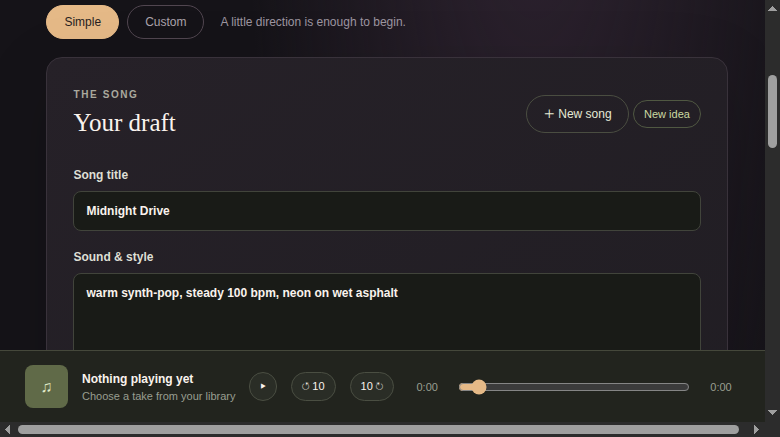
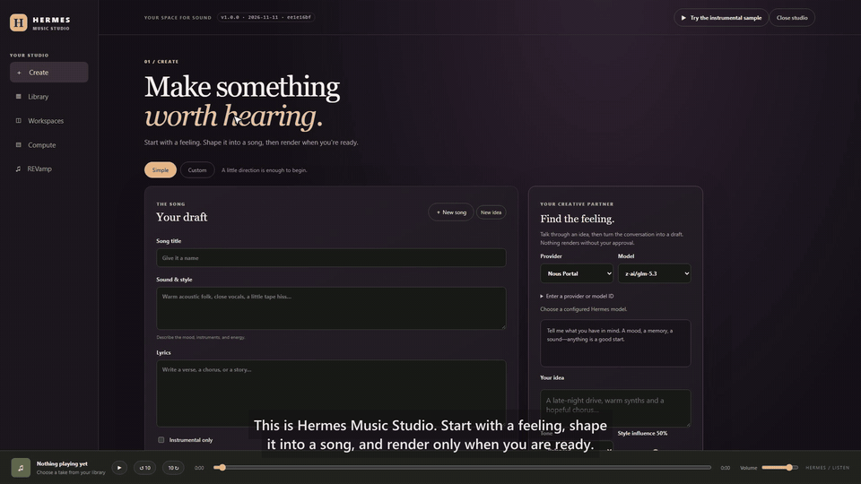
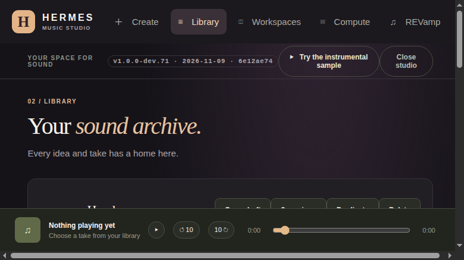
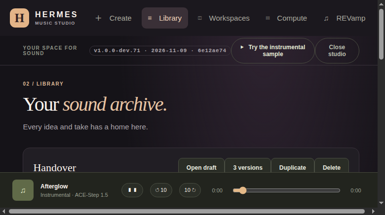
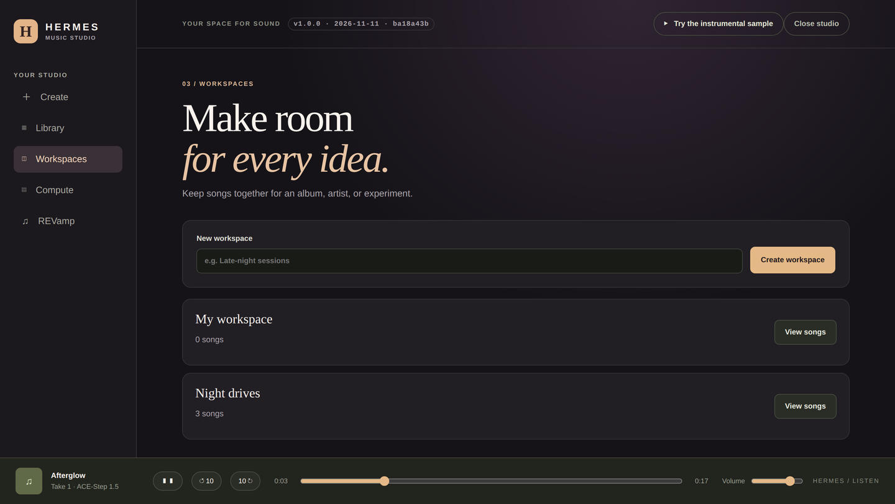
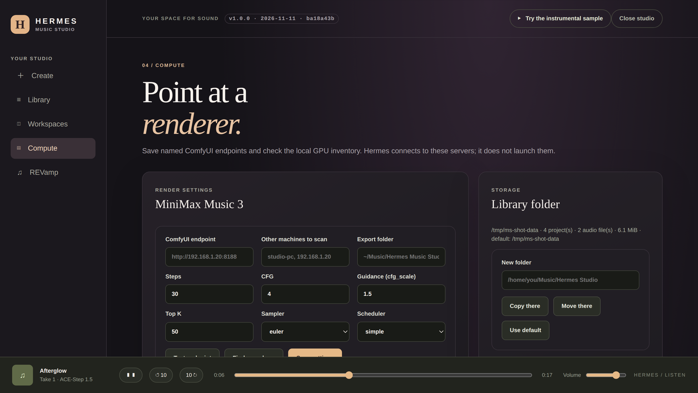
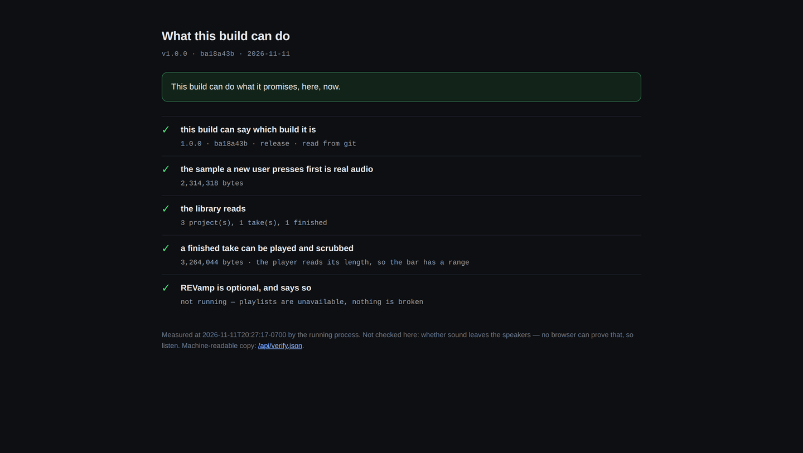
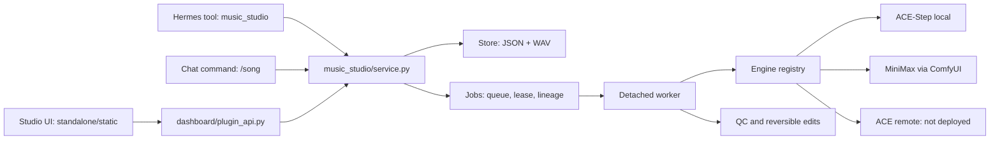

<p align="center"></p>

<h1 align="center">Hermes Music Studio</h1>

<p align="center"><em>Describe a song. Approve the draft. Render it on your own machine.</em></p>

<p align="center">
  <a href="https://github.com/KeyArgo/hermes-music-studio/actions/workflows/tests.yml"></a>
  <a href="TESTING.md"></a>
  <a href="https://github.com/KeyArgo/hermes-music-studio/releases/latest"></a>
  <a href="LICENSE"></a>
  <a href="https://github.com/NousResearch/hermes-agent"></a>
  <a href="#install"></a>
  <a href="requirements-dev.txt"></a>
  <a href="package.json"></a>
  <a href="https://github.com/KeyArgo/hermes-music-studio/stargazers"></a>
</p>



<p align="center"><sub>The draft is the gate: nothing renders until a person approves this exact version.</sub></p>

<p align="center"></p>

<p align="center"><sub><b>Describe a song, approve the draft, hear it.</b> <a href="https://x.com/MHArgonaut/status/2120635407113339039">Watch the full demo ▶</a></sub></p>

<p align="center"><a href="#install">Install</a> · <a href="#features">Features</a> · <a href="#how-it-works">How it works</a> · <a href="#documentation">Documentation</a> · <a href="#testing">Testing</a> · <a href="#contributing">Contributing</a></p>

## What it is

A studio inside Hermes. You describe a feeling; the agent turns it into a draft with a title, style,
lyrics and an engine; nothing is rendered until you approve that draft. Every take keeps the draft it
came from, its seed, its engine and its lineage, so a take is reproducible rather than a lucky
accident. The library, the worker and the audio stay on your machine.

## Why it's different

- **Approval is a step, not a warning.** The render endpoint refuses a draft that was not approved,
  and an approval is bound to the exact `updated_at` version you read.
- **A take can be re-made.** Draft, seed and engine travel with the take. A seed is a replay handle
  on the same runtime and hardware.
- **The build says which build it is.** The header reads `v1.0.0 · 2026-11-11 · ba18a43`, filled from
  the running server, never from a constant in the page.
- **The product proves itself.** `GET /api/verify` measures, at request time, that the sample is real
  audio, that the library reads, that a finished take is scrubbable because its response declares its
  length, and that REVamp's absence is a state rather than an error.

## Features

- **Draft → approve → render.** Title, caption, lyrics, instrumental flag, duration, BPM, key,
  vocal language and engine, with the approval token checked inside the write lock.
- **Two working engines behind one registry.** `ace_local` runs ACE-Step 1.5 on a local GPU with
  repaint and extend. `minimax_m3_comfy` renders MiniMax Music 3 through a ComfyUI server.
  `ace_remote` is registered and health-probed but not deployed.
- **One render at a time, across processes.** A detached worker takes a file lease; a crashed worker
  is reconciled by pid and start time, so a dead render cannot wedge the profile.
- **Takes are immutable.** Repaint, extend, section splice, fade and chorus preview create child
  takes; the parent WAV and its record stay untouched.
- **Range repaint.** Regenerate 3–30 s of an ACE take, then splice it back with the audio outside the
  range copied byte for byte.
- **Extend.** Append 10–60 s to a take of at least 20 s, up to 600 s total, with an equal-gain
  crossfade at 48 kHz stereo.
- **Save spot / Back to last spot.** A checkpoint keeps the draft, the keeper take with its audio
  SHA-256, the lineage and the playhead. Twenty are kept; a pinned one is never pruned.
- **Check this take / Fix it.** Compares a take with the request that produced it, reports only what
  it measured, and can retry a measurable failure with a fresh seed.
- **Change this part, in words.** `/song change` and the library's change box are deterministic:
  "add a fiddle" edits the style caption; "mute the drums" is refused with a sentence.
- **Versions, batch, presets, compare.** Three takes from one draft, a serial batch in one worker,
  saved style presets, and an A/B compare across ready engines.
- **A real player.** Play/pause, −10 s / +10 s, a scrubber that moves the audio, elapsed and total
  time, and a volume slider. Exported songs are ordinary `.wav` files.
- **Workspaces and cover art.** Group songs; upload PNG/JPEG/WebP up to 2 MiB or generate a cover
  through your configured Hermes image provider.
- **REVamp is optional.** Create a playlist from exported takes; with REVamp absent the screen says so
  and playing and exporting still work.
- **Chat and shell clients.** The `music_studio` tool has 20 actions, `/song` drives the same studio
  in chat, and `scripts/ms.py` is a standard-library HTTP client for shells and cron.
- **Honest surgery.** A tail trim and a −1 dBFS peak cap are stored as a new file with the source
  SHA-256; the raw take is never rewritten. Vocal evidence is `unknown` unless a real ASR result
  proves otherwise.

## Screenshots

<table>
  <tr>
    <td width="50%"><br><sub><b>Library</b> — every project and take, with seed and state.</sub></td>
    <td width="50%"><br><sub><b>Player</b> — a take streaming with a real length.</sub></td>
  </tr>
  <tr>
    <td width="50%"><br><sub><b>Workspaces</b> — keep a session in one place.</sub></td>
    <td width="50%"><br><sub><b>Compute</b> — endpoints, sampler knobs, library folder.</sub></td>
  </tr>
  <tr>
    <td width="50%"><br><sub><b>Verify</b> — what this build can prove on this machine.</sub></td>
    <td width="50%"><br><sub><b>Create</b> — the draft and the approval gate.</sub></td>
  </tr>
</table>

## Install

You need:

- **Python 3.13** with `fastapi`, `uvicorn`, `python-multipart` (`pip install -r requirements-dev.txt`)
- **Node 20+** only for the browser-side tests
- **Hermes** itself, since this ships as a plugin
- **Something to render with** — see [Limits](#limits)
- **Linux or macOS.** Windows is not a supported target for this release.

```bash
hermes plugins install KeyArgo/hermes-music-studio --yes-deps --enable
```

To pin an exact revision (what CI and the release script do):

```bash
hermes plugins install KeyArgo/hermes-music-studio --ref <full 40-character sha> --yes-deps --enable
```

A short SHA destroys the checkout; the installer needs all 40 characters. The desktop pane appears
after **Ctrl+K → Reload desktop plugins**.

Running from a clone instead:

```bash
git clone https://github.com/KeyArgo/hermes-music-studio
cd hermes-music-studio
pip install -r requirements-dev.txt
python3 -m uvicorn standalone.app:app --port 8770   # the studio on its own, no Hermes needed
```

### Upgrade

Updates come through Hermes; the studio never replaces its own code:

```bash
hermes plugins update hermes-music-studio
```

### Uninstall

```bash
hermes plugins uninstall hermes-music-studio
```

Uninstalling removes the plugin, not your library. Your projects and WAV files stay in the plugin data
folder until you delete it.

### Where your data lives

The plugin library lives under
`~/.hermes/profiles/<profile>/plugin-data/hermes-music-studio/` (or under `HERMES_HOME` when set).
The standalone server uses `$XDG_DATA_HOME/hewn-music-studio`, or
`~/.local/share/hewn-music-studio` when `XDG_DATA_HOME` is unset. Set `HEWN_STUDIO_DATA_DIR` to point
either at a different root. Settings, targets, presets and checkpoints live beside it; deleting the
folder deletes every project, take and WAV. Other folders and environment variables are listed in
[docs/CONFIGURATION.md](docs/CONFIGURATION.md).

## Quick start

1. Install the plugin and reload the desktop pane.
2. Open the pane and describe a song in **Create**. Pick an engine and length.
3. Press **Save draft**, read the draft, then **Approve draft**.
4. Press **Build the full song**. A detached worker renders it; the progress panel reports the take.
5. Play it in the footer, then **Export** it as a normal `.wav`.

With no engine installed, the studio still opens, the sample still plays, and the engine panel names
what is missing. It does not invent audio.

## How it works



The agent tool, the `/song` command and the dashboard all call `music_studio/service.py`. A generate,
repaint, extend or batch call queues a take and spawns `python -m music_studio.worker` in a new
session. The worker opens the render lease, claims its take, renders through the engine registry,
commits `succeeded` or `failed`, runs the quality pass, and exits. The requesting turn or HTTP request
can end immediately. `music_studio/jobs.py` owns the state machine, `music_studio/worker.py` owns the
render loop, and `music_studio/engines/` is the only place that knows a backend. The UI is plain
HTML/CSS/JS with no build step; `desktop/plugin.js` only frames the loopback host.

## Documentation

| Document | What it covers |
|---|---|
| [docs/README.md](docs/README.md) | Index of every document |
| [docs/USAGE.md](docs/USAGE.md) | Every user-facing feature, with screenshots |
| [docs/REFERENCE.md](docs/REFERENCE.md) | Every tool action, slash command, CLI command, HTTP route and config key |
| [docs/ARCHITECTURE.md](docs/ARCHITECTURE.md) | Processes, locks, state machine, data directory, route table |
| [docs/CONFIGURATION.md](docs/CONFIGURATION.md) | Environment variables and saved settings |
| [docs/TROUBLESHOOTING.md](docs/TROUBLESHOOTING.md) | Real failure modes and what they mean |
| [docs/AUDIO-QC.md](docs/AUDIO-QC.md) | The measurement gate: lengths, edits, vocal evidence |
| [docs/FAQ.md](docs/FAQ.md) | Short answers to the usual questions |
| [docs/DEVELOPMENT.md](docs/DEVELOPMENT.md) | Repo layout, test commands, CI |
| [TESTING.md](TESTING.md) | How to run each suite and the measured counts |
| [LIMITS.md](LIMITS.md) | What is unsupported, unmeasured or refused |
| [VERIFY.md](VERIFY.md) | Recorded measurements and the commands behind them |
| [CHANGELOG.md](CHANGELOG.md) | What changed in each release |
| [BACKEND.md](BACKEND.md) | The operator's short version of the architecture |
| [THIRD-PARTY.md](THIRD-PARTY.md) | Models, services and licences |
| [CONTRIBUTING.md](CONTRIBUTING.md) | Dev setup and the rules a change must keep |
| [SECURITY.md](SECURITY.md) | Supported version and private reporting |

## Privacy & security

- **What it stores.** Project JSON, raw take WAVs, QC edit WAVs, `engine-preference.json`,
  `presets.json`, `comfy-targets.json`, `studio-workspaces.json`, `engine-settings.json`,
  `library.json`, checkpoint files and worker logs, all under the plugin data directory you chose.
  Audio is opened with `O_NOFOLLOW`, checked as a regular file, and served with `nosniff`.
- **Network calls.** The studio calls only endpoints you configure: a ComfyUI server
  (`COMFYUI_URL` or a saved target), an optional ACE-Step HTTP server (`ACE_REMOTE_URL`), REVamp's
  local API at `127.0.0.1:8114`, and — only when you press the buttons — your configured Hermes model
  and image providers (creative partner and cover art) and Hugging Face for weights
  (`POST /api/studio/setup/hf`). It sends no telemetry and has no cloud audio service. "Check for a
  newer build" reports that Hermes owns updates; the studio does not fetch or install code itself.
- **Background processes.** A detached render worker per render (or batch), an ACE-Step subprocess in
  the runtime's own venv, a loopback studio host (`127.0.0.1`, a free port near 8775), `ffmpeg` for
  MiniMax's FLAC → WAV transcode, and read-only `nvidia-smi` probes for GPU attribution. Cover
  generation and the creative partner run the Hermes CLI; REVamp actions run `revampctl`.
- **Shell commands.** `git` is read for the version stamp. The studio never runs a shell string from
  user text and never changes a password or credential.
- **Local only.** The HTTP server binds loopback and rejects a non-loopback `Host` and cross-site
  writes. There is no multi-user authentication: anyone who can reach the loopback API can approve
  and render.

Read [SECURITY.md](SECURITY.md) for the supported version and private vulnerability reporting.

## Testing

```bash
# Python: contract, HTTP surface, store, jobs, engines against fakes
env -u PYTHONPATH TMPDIR=/tmp python3 -m pytest --rootdir=tests tests -q

# Browser-side logic: the player, the pane, the settings screen
npm install          # once
node --test tests/*.mjs
```

| Suite | Command | Measured result |
|---|---|---|
| Python | `env -u PYTHONPATH TMPDIR=/tmp python3 -m pytest --rootdir=tests tests -q` | **482 passed, 1 skipped, 130 subtests passed** |
| Browser-side | `node --test tests/*.mjs` | **42 passed** |
| Total | both suites | **524 passed, 1 skipped** |

`env -u PYTHONPATH` matters: a Hermes checkout on the path ships its own `tests` package, which wins
over this repo's folder and makes collection fail. The full breakdown, CI commands and the exact
summary lines are in [TESTING.md](TESTING.md).

## Limits

- **No model ships here.** Rendering needs a reachable engine: a ComfyUI host with MiniMax Music 3, or
  a local ACE-Step checkout. With neither, the studio still opens, the sample still plays, and the
  engine panel says what is missing.
- **One render at a time per profile.** A second generate returns `GPU busy`.
- **No automated test performs a real render.** The suites use fake engines. Audio quality is judged
  by listening.
- **MiniMax cannot repaint or extend**, and `ace_remote` is registered but undeployed.
- **A seed reproduces on the same runtime and hardware**, not across GPUs or checkpoints.
- **macOS is untested in CI.** Linux is the daily path; Windows is not supported.

The complete list, with the code that enforces each item, is in [LIMITS.md](LIMITS.md).

## Contributing

Contributions that keep the honesty rule are welcome: every claim backed by a command in
[VERIFY.md](VERIFY.md) or a test that fails when the claim is false. Start with
[CONTRIBUTING.md](CONTRIBUTING.md), and read the [Code of Conduct](CODE_OF_CONDUCT.md).

## License

MIT. See [LICENSE](LICENSE). Models and services carry their own licences, recorded in
[THIRD-PARTY.md](THIRD-PARTY.md).

## Acknowledgements

- [ACE-Step 1.5](https://github.com/ACE-Step/ACE-Step-1.5) (MIT) for the local music model.
- [MiniMax Music 3](https://huggingface.co/MiniMaxAI/MiniMax-Music3) for the hosted model, under its
  community licence.
- [ComfyUI](https://github.com/comfyanonymous/ComfyUI) for the MiniMax graph runner.
- [ffmpeg](https://ffmpeg.org/) for FLAC → WAV conversion.
- [Hermes Agent](https://github.com/NousResearch/hermes-agent) for the plugin host.
- [REVamp](https://github.com/KeyArgo/hermes-revamp) for the optional player integration.
- [InovinLabs](https://github.com/inovinlabs) for the product and its direction.

<p align="center">Built by <a href="https://github.com/KeyArgo">KeyArgo</a> · InovinLabs</p>
