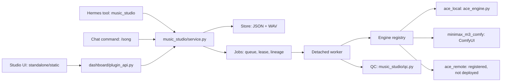

# Architecture

How Hermes Music Studio is put together: one Hermes plugin, one dashboard tab, one local JSON store,
one detached render worker, and an engine registry behind it. Everything runs on one machine, under
one OS user, for one profile.

Applies to 1.0.0 · revised 2026-11-11 · back to [docs/README.md](README.md).



The spawn is plain: no file descriptors are inherited. The worker opens the render lease itself as
its first act.

## Process model

```
Hermes gateway process (one per host)
┌───────────────────────────────────────────────────────────────┐
│  plugin: hermes-music-studio                                  │
│                                                               │
│  agent turn ──► music_studio tool ──► music_studio.service    │
│  dashboard tab ─► HTTP /api/plugins/… ─► dashboard/plugin_api │
│                        │                                      │
│                        ├─ Store  (<data>/*.json, flock)       │
│                        ├─ Registry ─► engine describe/health  │
│                        └─ enqueue() ── spawn ──┐              │
└────────────────────────────────────────────────┼──────────────┘
                                                  │ start_new_session=True
                                                  ▼
                        detached worker: python -m music_studio.worker
                        ┌───────────────────────────────────────────┐
                        │ takes .worker.lock (render lease)         │
                        │ claims take → running                     │
                        │ Registry.render(take.engine_id, request)  │
                        │   ├─ ace_local ─► ace_engine.generate/    │
                        │   │              repaint/extend           │
                        │   │   └─ flock <runtime>/ace-studio-gpu.lock
                        │   │      subprocess <runtime>/venv/bin/   │
                        │   │                 python ace_worker.py  │
                        │   ├─ minimax_m3_comfy ─► HTTP ComfyUI     │
                        │   └─ ace_remote ─► HTTP acestep.api_server│
                        │ commits succeeded/failed → releases lease │
                        │ QC pass (measure, then reversible edit)   │
                        └───────────────────────────────────────────┘
```

Layers, in order:

1. **Gateway / plugin host.** Loads `__init__.py`, which registers the `music_studio` tool, the
   `/song` command and the bundled `music-studio` skill. `dashboard/plugin_api.py` is mounted by the
   same host at `/api/plugins/hermes-music-studio`. Both halves call `music_studio/service.py`; the
   dashboard reaches it over local HTTP, the agent in-process.
2. **Detached render worker.** `music_studio/service.py` starts `python -m music_studio.worker` in a
   new session with `stdin=DEVNULL` and stdout/stderr to `<data>/worker-logs/<take_id>.log`. The
   requesting process is free to exit; the render is not tied to an agent turn. A batch is one worker
   looping over queued takes, so it holds one lease for the whole batch.
3. **Engine registry.** `music_studio/engines/registry.py` selects an `Engine`, checks its declared
   capabilities, and is the only render entry point. The take's pinned `engine_id` is passed
   explicitly, so a take can never switch backend between queueing and rendering.
4. **Adapters.** `music_studio/engines/ace_local.py` is a thin delegate to root-level `ace_engine.py`
   (bounded subprocess, `ace_worker.py`, ACE flock, progress milestones, process-group kill, WAV
   validation); it has no render code of its own. `music_studio/engines/minimax_m3_comfy.py` submits
   a ComfyUI API graph, polls `/history`, fetches `/view`, and losslessly transcodes FLAC to PCM WAV.
   `music_studio/engines/ace_remote.py` speaks the `acestep.api_server` HTTP protocol and is
   undeployed.

Why detached rather than a thread or an awaited subprocess: a take takes tens of seconds to minutes,
while an agent turn or dashboard request is short-lived. The worker must own the lease for the whole
render and commit the final take state itself. It also means "the process that asked" is never the
process that decides whether a take succeeded.

## Engine registry

`music_studio/engines/contract.py` defines the entire cross-engine vocabulary. Nothing outside an
adapter knows a backend-specific field.

| Concept | Shape |
|---|---|
| `Engine` | class attrs `id`, `label`, `kind` (`local`/`remote`), `requirements`; properties `limits`, `capabilities`; `health()`; `render()` → `RenderResult` |
| `Limits` | `min_seconds`, `max_seconds`, `recommended_seconds` (validated `0 < min ≤ recommended ≤ max`) |
| `Capabilities` | `instrumental`, `vocal_language`, `repaint`, `continuation`, `batch` — false means the studio must not offer it |
| `RenderRequest` | caption, duration, seed, lyrics, instrumental, vocal language, bpm, keyscale, `output_dir`, timeout, `mode`, `source_wav`, repaint range, `extend_seconds` |
| `RenderResult` | `wav` bytes + `metadata`; WAV framing and full frame count validated; `engine_id` mandatory |
| `EngineStatus` | `ready`, `busy`, `degraded`, `unavailable` or `error`; `checks[]` names each probe; `available` is true for ready/busy/degraded |

`MODES = ('generate', 'repaint', 'extend')`. The base class refuses a repaint when
`capabilities.repaint` is false and an extend when `continuation` is false, before any work starts,
with `CapabilityUnsupported` (HTTP 409, engine and operation named). Duration limits bound `generate`
only; repaint inherits its parent's length and extend deliberately exceeds it, so each adapter
validates those geometries.

Registered engines (`default_engines()` in `music_studio/engines/registry.py`):

| id | label | kind | limits | repaint | extend | health source |
|---|---|---|---|---|---|---|
| `ace_local` | ACE-Step 1.5 (local GPU) | local | 10–180 s | yes | yes | interpreter, checkpoints, source tree |
| `minimax_m3_comfy` | MiniMax Music 3 (ComfyUI) | remote | 10–360 s | no | no | `/system_stats`, `/object_info` nodes, model lists, CLIP type, audio save format |
| `ace_remote` | ACE-Step 1.5 (remote) | remote | 10–360 s | no | no | `/health` + `models_initialized` |

`ALIASES = {'ace': 'ace_local'}` keeps drafts approved before engine ids existed renderable. The
legacy `ace` id is the store's default draft value.

### Selection policy

`service.resolve_engine()` picks: explicit `engine_id` → the draft's `engine` → the registry default.
Unknown ids raise (`400`); registered-but-unavailable ids raise `EngineUnavailable` (`409`) with the
health detail. There is no silent substitution on an explicit or draft-named engine.

`Registry.select()` is the fallback path used when no explicit engine is given: the stored preference
is used if it is `ready`/`degraded`, otherwise the first selectable engine, recording
`requested_id`, `engine_id`, `fell_back`, `reason` and the `skipped[]` list of unhealthy engines in
the result metadata.

Health probes are cached for `HEALTH_TTL_SECONDS = 10.0` so a polling UI never hammers a remote server
per keystroke. `engine-preference.json` holds `{preferred, allow_fallback, updated_at}`; it is read
per selection and written atomically.

`/status.engines[]` is the client contract: each engine's id, label, kind, availability,
`supports_generate`, `selectable`, `selectable_reason`, `requirements`, `limits`, `capabilities` and
full `status`. The UI builds its picker from that list and hardcodes no backend name.

## Worker and lease model

Three advisory `flock`s, each with a different scope and lifetime.

| Lock | File | Mode | Held by | Held for | Contention behaviour |
|---|---|---|---|---|---|
| store lock | `<data>/.lock` | `LOCK_EX` | any process mutating a project | one read-modify-write + `os.replace` | blocks |
| render lease | `<data>/.worker.lock` | `LOCK_EX \| LOCK_NB` | the detached worker | the entire render (or batch) | worker aborts its take with `GPU busy: another render owns the worker lease` |
| engine lock | `<runtime>/ace-studio-gpu.lock` | `LOCK_EX \| LOCK_NB` | `ace_engine` | one ACE subprocess run | raises `ACE GPU worker busy` |

- **Store lock** serializes every project mutation: create, update, approve, take transitions,
  progress milestones, QC edits and reconciliation. Readers do not lock; they read a file that is
  only ever replaced atomically.
- **Render lease** enforces one render per profile in two places: `enqueue` refuses while any take is
  `queued` or `running`, and the worker takes the lease non-blockingly before claiming. The kernel
  releases the lease on any worker exit, including SIGKILL — that is why a crashed render is
  recoverable without an operator.
- **Engine lock** lives next to the ACE runtime, not in plugin data, so two adapters or profiles
  pointing at the same runtime cannot load the model twice. It is advisory: other GPU workloads are
  not excluded.
- `minimax_m3_comfy` consults the ACE lock only when its ComfyUI host resolves to this machine.
- Lock ordering is always store lock *inside* the lease or engine lock. `reconcile_interrupted`
  deliberately takes the render lease first so it cannot mark a genuinely running take as failed.

### Take state machine

```
queued ──claim──► running ──succeed──► succeeded ──qc──► (qc metadata + edit)
  │                  │
  │                  └──fail───► failed
  └──abort──► failed
```

- `enqueue` refuses an unapproved draft, re-runs readiness, and refuses when any take in any project
  is `queued` or `running`.
- `claim` is the worker's atomic ownership step: `queued → running` with pid and pid start time. A
  `running` take is accepted only by the same pid.
- `succeed` writes the WAV, then commits `succeeded` + `audio_file` under the store lock. A crash
  between the two leaves an orphan WAV, never a false success.
- The worker tracks whether it committed a terminal state; exiting without one aborts its take, so a
  crash cannot wedge the profile.

### Recovery

Each take records `pid` and `pid_start` (field 22 of `/proc/<pid>/stat`). `process_alive` checks both,
so a recycled pid cannot keep a dead take alive. `reconcile_dead_workers` runs on plugin import and
every `GET /status`; it marks `queued`/`running` takes with a dead or missing worker as
`failed: "worker died"`, freeing the lease. Takes younger than `SPAWN_GRACE_SECONDS` (10 s) with no pid
are skipped so a status poll cannot kill a starting render.

`reconcile_interrupted(confirmed=True)` is the blunt manual sweep: it takes the lease and fails every
queued/running take. The route is `POST /recover`, 409 without `{"confirm": true}`.

## Take lineage

Takes are immutable records of what one engine returned. Editing never mutates a take; it creates a
child.

| Field | On a plain take | On a child take |
|---|---|---|
| `kind` | `generate` | `repaint`, `extension` or a section/snippet child |
| `parent_take_id` | null | parent's `take_id` |
| `lineage` | `[]` | parent's `lineage` + parent's `take_id` |
| `engine_id` | chosen engine | inherited from the parent take |
| `snapshot` | draft at queue time | draft at queue time (child snapshot) |
| `range_start_s` / `range_end_s` | null | repaint geometry, in parent seconds |
| `extend_seconds` / `splice_start` / `overlap_seconds` | null | extension geometry |
| `source_duration` / `planned_duration` | null | parent length and intended child length |

- **Repaint** (`POST /repaint`) regenerates one in-place range of 3–30 s. ACE masks the source's latent
  frames inside the range and preserves everything outside; the output is the parent's length (verified
  within 0.25 s), not a shorter clip. The server refuses an engine whose `repaint` is false with 409
  before queueing, and the worker re-checks.
- **Extend** (`POST /extend`) appends 10–60 s to a take of at least 20 s, up to 600 s total.
  `plan_extension()` regenerates a tail overlap (min(8 s, 20 % of the take)), out-paints to
  `source + extend`, then `music_studio/longform.py` splices with a raised-cosine **equal-gain**
  crossfade (`w_a + w_b == 1`, zero slope at both ends). Only 48 kHz stereo pcm_s16le is accepted.
- **Section splice and snippet** (`POST /section/render`, `/section/splice`, `/snippet`,
  `/snippet/splice`) render a range as its own child and copy the parent's bytes outside that range.
- Repaint, extend, splice and fade results are **new takes**, never replacements. The parent WAV and
  its JSON record are untouched.

## QC and the edit layer

QC is a measurement pass that runs in the worker after the take is committed `succeeded`. It can never
fail a take: a QC exception costs measurements, not the render. [AUDIO-QC.md](AUDIO-QC.md) is the
field-level contract; the architecture view is:

1. `music_studio/qc.py` `analyse_wav()` measures `file_s`, `musical_end_s` (last frame above
   −50 dBFS), `tail_silence_s`, `peak_dbfs`, `clipped_frames`.
2. `music_studio/jobs.py` `record_qc()` validates and stores the `qc` block on the raw take.
3. `qc.plan_edit()` decides whether a tail trim and/or a −1 dBFS peak cap is needed;
   `jobs.apply_qc_edit()` renders it and writes a new WAV under a new uuid, appending an `edits[]`
   entry with the source's SHA-256 and the transform parameters. `take.playable_edit_id` points at it.

The raw take is never modified. Audio routes accept `?edit=<edit_id>` (`/audio`, `/audio-json`,
`/download`, `/peaks`) and serve the edit's bytes and length; the `qc` block continues to describe the
raw file.

## Data directory

`plugin_data_dir("hermes-music-studio")`, i.e.
`~/.hermes/profiles/<profile>/plugin-data/hermes-music-studio/`.

| Path | Contents |
|---|---|
| `<uuid>.json` | one project: draft fields, sections, `approved`, `updated_at`, `takes[]` |
| `<take_id>.wav` | raw render, referenced only by a `succeeded` take |
| `<edit_id>.wav` | QC edit (trim/peak cap); raw take untouched |
| `.lock` | store flock |
| `.worker.lock` | render-lease flock |
| `engine-preference.json` | preferred engine and fallback flag |
| `engine-settings.json` | ComfyUI endpoint, scan hosts, export folder, ACE paths, sampler knobs |
| `library.json` | pointer to a moved library folder |
| `comfy-targets.json` | named ComfyUI endpoints |
| `studio-workspaces.json` | workspace names and project assignments |
| `presets.json` | saved style presets |
| `studio-host.json` / `studio-host.log` | loopback host state and log |
| `worker-logs/<take_id>.log` | detached worker stdout/stderr |
| `.project-*`, `.audio-*` | transient temp files during atomic saves |
| `ace-job-*` | transient ACE scratch dir: `input.json`, `worker.log`, `output.wav` |

Only `<uuid>.json` files with valid UUID stems are projects, so scratch and temp files are ignored by
`all()`. Deleting the directory resets the studio; deleting a WAV leaves a take whose audio route
answers `audio unavailable`.

## Other modules in the tree

| File | Role |
|---|---|
| `music_studio/checkpoints.py` | Save spot / list / restore, with the kept take and its audio SHA-256 |
| `music_studio/takecheck.py` | Compare a take to its request; retry a measurable failure |
| `music_studio/intent.py` | Plain-words draft changes and range instructions |
| `music_studio/chorus.py` | Chorus preview and compare helpers |
| `music_studio/compare.py` | Render one draft on several ready engines as separate takes |
| `music_studio/edit.py` | Non-destructive PCM splice, fade and section replacement |
| `music_studio/longform.py` | Equal-gain crossfade and extension geometry |
| `music_studio/export.py` | Copy a finished take into the export folder with a readable name |
| `music_studio/settings.py` | Read, validate and write `engine-settings.json` |
| `music_studio/network.py` | Named ComfyUI targets and URL validation |
| `music_studio/discovery.py` | Find a renderer on saved/loopback/LAN hosts |
| `music_studio/setup.py` | Probe ComfyUI/ACE, plan and download HF weights, store cloud keys |
| `music_studio/sample.py`, `demo.py` | The shipped instrumental sample and the demo take card |
| `music_studio/about.py`, `version_stamp.py`, `updates.py` | Build identity, diagnostics and update notice |
| `music_studio/host.py`, `host_launcher.py`, `lifecycle.py` | Loopback host, port choice and idle/parent watchdog |
| `standalone/ideas.py`, `workspaces.py`, `revamp.py`, `hardware.py` | Creative partner, workspaces, REVamp bridge, `nvidia-smi` |
| `dashboard/plugin_api.py` | The HTTP surface, mounted under `/api/plugins/hermes-music-studio` |
| `desktop/plugin.js` | The Hermes pane: a frame around the loopback studio, nothing more |

## Dashboard API

Mounted under `/api/plugins/hermes-music-studio`; the standalone server mounts the same router under
`/api`. [REFERENCE.md](REFERENCE.md) has every route with its parameters. The core set:

| Route | Purpose |
|---|---|
| `GET /status` | engines, availability, limits, projects and takes with progress/ETA; reconciles dead workers |
| `POST /create`, `/update`, `/change`, `/approve` | draft lifecycle; approval needs `base_updated_at` |
| `POST /generate`, `/repaint`, `/extend`, `/batch`, `/batch/cancel` | queue work on a pinned engine |
| `POST /checkpoint`, `/checkpoint/restore`; `GET /checkpoints/{id}` | save spot and go back |
| `POST /take-check`, `/snippet`, `/snippet/splice` | check a take, edit a range |
| `POST /versions`, `/section/render`, `/section/splice`, `/fade`, `/compare` | other ways to make child takes |
| `GET /presets`, `POST /presets`, `DELETE /presets/{name}` | saved style presets |
| `POST /recover` | fail every queued/running take; 409 without `{"confirm": true}` |
| `GET /projects/{id}/takes/{take}/audio`, `/download`, `/audio-json`, `/peaks` | audio and waveform |
| `GET /settings`, `POST /settings`, `/settings/test`, `/discover` | engine settings and endpoint probes |
| `GET /library`, `POST /library/relocate`, `/library/reset` | library folder |
| `GET /verify`, `/verify.json` | what this build can prove on this machine |
| `GET /about`, `POST /about/diagnostics` | build identity and a copyable report |

Error mapping: `CapabilityUnsupported` and `EngineUnavailable` → 409 with the engine's message;
other `ValueError` → 409 for approval/busy/stale/confirm conflicts and 400 otherwise; missing
project/take → 404; `RuntimeError` (engine/spawn) → 503; oversized or malformed bodies → 413/400;
anything else → 500. `invalid UUID` surfaces as 400 before any path is touched.

## Delivery and trust boundaries

- Project and take ids are canonical UUID strings; `valid_id` reparses them and the store only builds
  paths from the reparsed value.
- Audio is opened with `O_NOFOLLOW`, `fstat`-checked as a regular file, and served with
  `X-Content-Type-Options: nosniff`.
- Text limits: title 200, idea 2000, caption 512, lyrics 4096 characters, enforced by the store and
  re-checked at approval. Caption/lyrics caps match the engine contract exactly.
- Request bodies are capped at 256 KiB and must be a JSON object.
- Audio size caps: 100 MiB in the adapter and in `Jobs.succeed`, 8 MiB on the panel's base64 route.
- The ACE subprocess inherits `HF_HUB_OFFLINE=1`, `TRANSFORMERS_OFFLINE=1`, `HF_DATASETS_OFFLINE=1`,
  pinned `HF_HOME`/`TRITON_CACHE_DIR`, and `PYTHONPATH` pointing at the ACE source. These are
  environment hints, not a network sandbox.
- The MiniMax adapter talks to one configured ComfyUI URL. Its metadata carries the licence id and
  notice required by the MiniMax-Music3 Community License.
- The tool runs in the gateway process and is trusted exactly as much as any in-process plugin tool.
- The loopback host binds `127.0.0.1`, requires a loopback `Host`, and rejects cross-site writes. It
  has no multi-user authentication.

## Known structural limits

- One render per profile, enforced by the render lease; there is no cross-host queue. A batch is
  serial inside one worker.
- The lease is cross-process on one host; the engine lock is advisory.
- The ACE subprocess has a timeout of three times its modelled wall clock (never under 3 min); on
  expiry the adapter kills the whole process group. The detached worker has no parent-side timeout.
- Progress is a coarse elapsed-time estimate, not per-step feedback.
- A repaint returns the engine's own normalised master. The untouched region is bit-identical only up
  to a global per-take gain (measured 0.89125 on a 40 s parent, 16-bit residual ~3.1e-5).
- Extend is stitched only for 48 kHz stereo pcm_s16le; other formats fail loudly.
- A seed reproduces a take on the same runtime and hardware; it is not a cross-hardware guarantee.
- No automated test performs a real render. Audio quality is verified by listening.

The full product limits are in [../LIMITS.md](../LIMITS.md).
