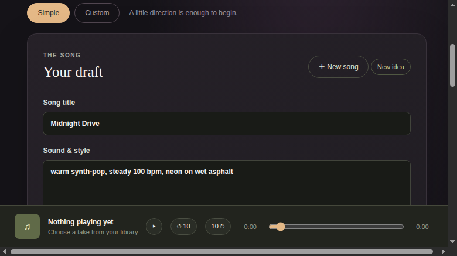
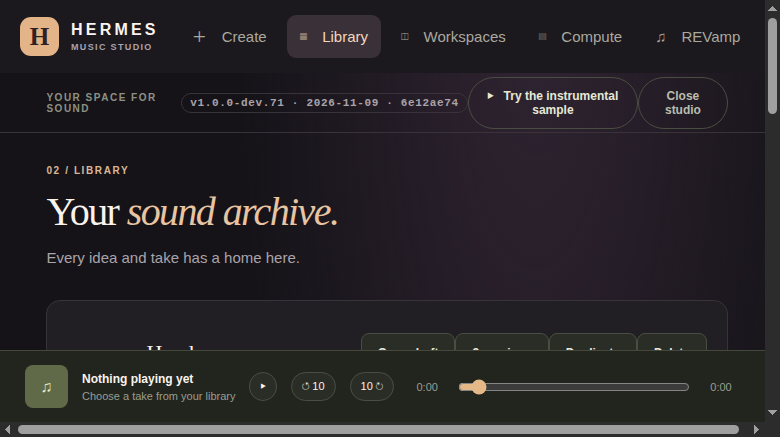
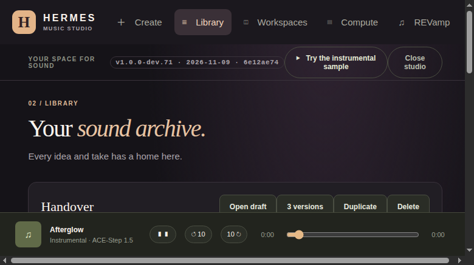
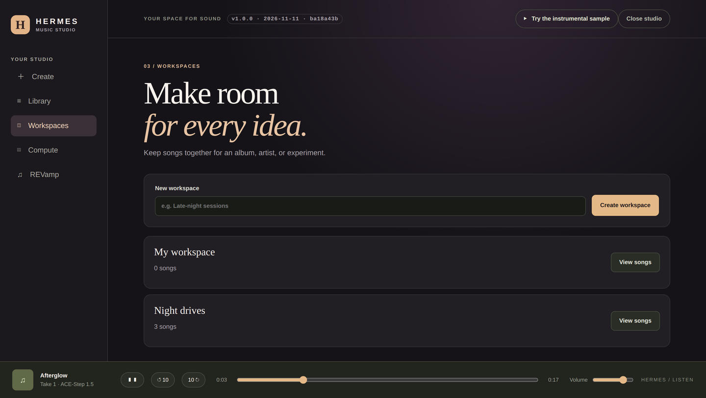
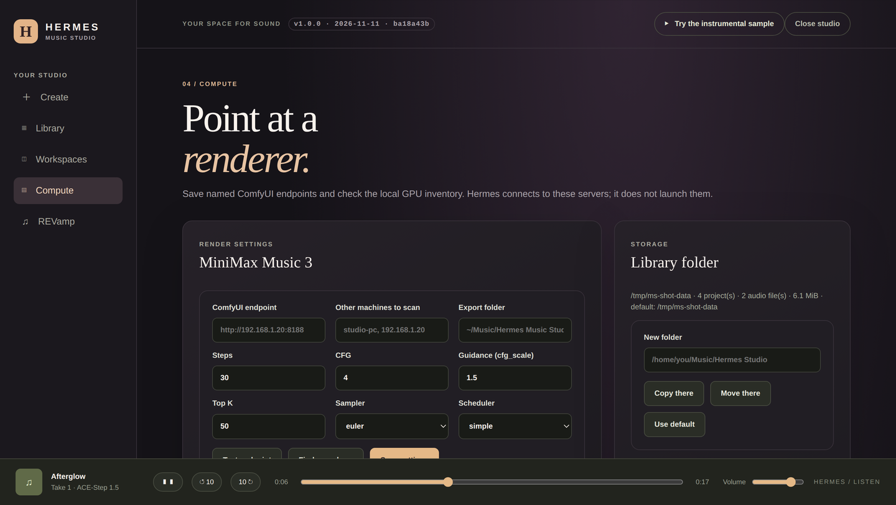

# Usage

A walkthrough of every user-facing feature, from the first draft to a file in your music folder.

Applies to 1.0.0 · revised 2026-11-11 · back to [docs/README.md](README.md).



## The first sixty seconds

1. Open the Music Studio pane (or run the standalone host from a clone — it refuses `/api` without a token, so:

   ```bash
TOKEN=$(python3 -c 'import secrets; print(secrets.token_urlsafe(32))')
HEWN_STUDIO_TOKEN=$TOKEN python3 -m uvicorn standalone.app:app --port 8770
# then open http://127.0.0.1:8770/?token=$TOKEN — the host refuses /api without it
   ```
2. In **Create**, type a title and a description of the sound. The description becomes the engine's
   caption, so it is the one text field that reaches the model.
3. Choose **Simple** or **Custom**. Custom exposes tempo, key, vocal language and MiniMax guidance.
4. Press **Save draft**. Read the draft. Press **Approve draft**.
5. Press **Build the full song**. The progress panel reports queued/running, an estimate, and the
   engine it is using.
6. When it finishes, press **Play** in the library or in the footer, then **Export**.

The footer player is always available: play/pause, ten seconds back and forward, a scrubber, elapsed
and total time, and a volume slider. The sample button in the top bar plays the shipped instrumental
without needing any engine.

## Create

| Control | What it does |
|---|---|
| **Song title** | Up to 200 characters; used for the project, export filename and player title |
| **Sound & style** | The engine caption, required, up to 512 characters |
| **Lyrics** | Required unless **Instrumental only**, up to 4096 characters |
| **Music engine** | `ACE-Step 1.5` (`ace_local`) or `MiniMax Music 3` (`minimax_m3_comfy`) |
| **Length** | The engine's own window: 10–180 s for ACE, 10–360 s for MiniMax |
| **Tempo / key / vocal language** | Custom mode; stored in the draft and sent to the engine |
| **MiniMax music guidance** | Custom mode, 0.5–3.0; ACE-Step turbo does not accept it, so it is hidden there |
| **Workspace** | The workspace this song belongs to |

**Save draft** creates or updates the project. **Approve draft** enables only when the form is saved
and unchanged; an edit revokes the approval. **Build the full song** is disabled until the draft is
approved and the selected engine is ready. **Hear the chorus** renders a 25 s preview without
approving the full song.

### Creative partner

The right-hand panel talks to a configured Hermes provider and model. It lists the models Hermes
knows, sends the conversation and your tone/style influence, and shows a suggested draft. **Fill my
draft** copies the suggestion into the form; it does not save or approve it. Model use may incur the
provider's ordinary charges. With no Hermes model available, the panel says so and the rest of the
studio still works.

### Cover art

Upload a PNG, JPEG or WebP up to 2 MiB, or generate one with your configured Hermes image provider.
Cover art arrives two ways, both without the studio spending model credits itself: upload a PNG, JPEG or
WebP (2 MiB) in the project, or ask the assistant for a picture and let it save the file it makes as the
cover (`set_cover`). The studio only accepts an image from the studio folder, Downloads, Pictures or the
temp directory, and it reads the bytes rather than the extension. The cover is stored with the project and
shown in the library.

## Library



Every project shows its caption and its takes. A take row carries its state, engine and seed, and the
actions that apply to that state:

- **Play** streams the take in the footer player.
- **Export** copies the newest finished audio into the export folder.
- **Add to REVamp** hands the take to the optional REVamp integration.
- **Check this take** compares the take with the request; **Fix it** retries a measurable failure with
  a fresh seed.
- **Change this part** opens an inline form on the row: start, end, new words, render. The child is
  spliced back automatically when it finishes.
- **Fade out** adds a faded copy as a new take.
- **Delete take** removes one take and its audio; **Delete** removes the project and refuses while it
  is rendering.
- **3 versions** renders three takes from the same approved draft, one seed each.
- **Compare engines** renders the draft on every ready engine as separate takes.
- **Duplicate** copies the project and every WAV with new ids.
- **Open draft** loads the project back into Create.

The change box at the top of a project takes plain words. "add a fiddle" appends `fiddle` to the one
style caption; "go dark" expands to a small, deterministic set of descriptors; "half-time in the
bridge" is sent as a section feel because neither engine accepts a second tempo. "mute the drums" is
refused with a sentence: both engines render one mixed stereo take.

### Save spot and go back

**Save spot** stores the whole draft, the kept take with the SHA-256 of its audio, the take lineage with
seeds, anything queued or running, and the playhead. Twenty spots are kept; a pinned spot is never
pruned. **Back to last spot** restores the draft and the keeper and says plainly that the approval was
revoked — you are looking at a different draft and should approve it again.

ACE replays exactly from a seed, so an ACE spot can be rebuilt from it. MiniMax's seed replay was
never measured, so an M3 spot keeps the audio file itself instead of promising a rebuild.

## Player and export



The footer player reads the length the server declares, so the scrubber can move the audio. Export
writes a normal `.wav` into `~/Music/Hermes Music Studio` by default (a setting). Names are readable
and sanitised, and a second export of the same take reuses the file it already wrote rather than
filling the folder with "Song (2)", "Song (3)". The library keeps its master; export is a copy.

## Workspaces



Create a workspace, then pick it in Create's **Workspace** select. **View songs** filters the library
to that workspace. Workspaces are local JSON (`studio-workspaces.json`); they do not move audio.

## Compute



- **Render settings** save the ComfyUI endpoint, extra scan hosts, export folder and the MiniMax
  sampler knobs (steps, CFG, guidance, top K, sampler, scheduler). Values are validated at save time.
- **Test endpoint** probes the server and lists every check; **Find a renderer** scans loopback ports,
  the saved endpoint and your scan hosts.
- **Library folder** copies or moves the library and points the profile at it; **Use default** removes
  the pointer. A copy never deletes anything.
- **ComfyUI targets** save named endpoints; a take pins the exact URL it was preflighted against.
- **Local hardware** is a read-only `nvidia-smi` inventory. A GPU is attributed to a take only when
  `nvidia-smi` reports that take's exact PID on a device.
- **Set up an engine** has three paths: a server you already run, a Hugging Face model download, or a
  hosted API with a key. Each tests before it saves and names the check that failed.
- **Version**, **Companion**, **Contribute** and **Report a problem** round out the panel.
  **Copy diagnostics** includes the version, platform, library path, counts and newest failed take.

## REVamp (optional)

Only takes you add appear in the REVamp screen. Create a playlist from exported takes; the studio
exports the files, adds the folder to REVamp's library, rescans, then creates the playlist. With
REVamp absent the screen says so, and playing and exporting still work. A take plays from the studio
while it is running; keep the studio open for that.

## From a chat: the `music_studio` tool

The tool has 20 actions: `status`, `doctor`, `create`, `update`, `change`, `keep`, `snippet`,
`snippet_splice`, `check_take`, `checkpoint`, `checkpoints`, `restore`, `approve`, `render`, `queue`,
`takes`, `export`, `wait`, `compare` and `compare_status`. The usual loop:

```text
status
create   {draft:{title, caption, lyrics, duration_seconds, instrumental, engine}}
approve  {project_id, updated_at}        # only after the person said yes in chat
render   {project_id, timeout_s:240}     # queues a worker and waits
takes    {project_id}
export   {project_id}
```

`render` waits so a chat can answer with a file; `queue` returns as soon as the worker is spawned. The
approval gate survives the shortcut: `approve` must carry the `updated_at` token of the draft the
person actually read, and `render` refuses an unapproved draft. `compare` renders the same approved
draft on several ready engines. The full parameter table is in [REFERENCE.md](REFERENCE.md).

## In chat: `/song`

```
/song                  what is in the library, with ids and engine per song
/song go <id>          show the draft that would render — and queue nothing
/song go <id> now      approve that exact version and queue one take
/song takes <id>       every take with its state, engine and measured length
/song play <id>        the newest finished take's audio URL
/song export <id>      copy the newest finished take into your music folder
/song change <id> …    plain words → a different draft
/song keep <id>        remember the newest finished take as this song's keeper
/song check <id> [retry] did the take do what you asked? facts only, and a retry if one failed
/song save [label]     save your spot; /song saves lists them, /song back <id> returns
/song snippet <id> 10-18 go darker   re-render only 10–18 s, then /song splice <id> <take>
/song splice <id> <take>             copy the parent back outside the range
```

The first `go` is the gate; `go … now` is the commitment. If the draft changes in between, the old
confirmation is refused rather than rendering something you did not review.

## From a shell: `scripts/ms.py`

A thin HTTP client with no dependencies beyond the standard library:

```bash
python3 scripts/ms.py status
python3 scripts/ms.py doctor
python3 scripts/ms.py create --draft '{"title": "Night drive", "caption": "synthwave", "lyrics": "…", "duration_seconds": 30}'
python3 scripts/ms.py approve --project <id> --updated-at <token>
python3 scripts/ms.py render  --project <id> --timeout 240
python3 scripts/ms.py takes   --project <id>
python3 scripts/ms.py export  --project <id>
```

It finds the loopback host from `studio-host.json` (or `--base`), prints JSON, and exits 1 when the
studio refuses and 2 when no host answers.

## Closing the studio

**Close studio** in the top bar stops the loopback host and leaves the library untouched. Reopen the
pane to start another host. The host also exits after five idle minutes, or when the Hermes process
that started it is gone.

## What is not here

No stems, mixing, mastering, vocal tuning, LoRA training, reference-audio conditioning or lyric timing
export. No arrangement editor beyond sections. No cloud audio service and no mock engine. See
[../LIMITS.md](../LIMITS.md).
